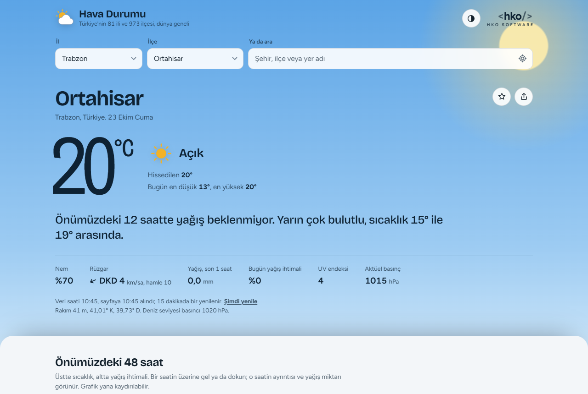

# Hava Durumu

**Hemen kullan:** https://nihathko.github.io/hava-durumu/

Türkiye'nin 81 ili ve 973 ilçesi için reklamsız, çerezsiz hava durumu sitesi. Yapısı MGM'nin sitesinden esinlenir: tahminler, son durum, radar ve uydu, iklim, denizcilik, ziraat ve özel tahminler. Sunucu gerektirmez; veriler tarayıcıdan doğrudan ücretsiz ve açık kaynaklardan alınır. Telefona ve bilgisayara uygulama olarak da yüklenebilir.

## Sayfalar

| Sayfa | Neler var |
|---|---|
| [Hava durumu](https://nihathko.github.io/hava-durumu/) | Anlık durum ve tek cümlelik özet, 48 saatlik grafik, 3 saatlik tablo, 14 güne kadar tahmin ve 1991–2020 karşılaştırması, hava kalitesi, polen, güneş ve ay, MGM resmi tahmini, favoriler, paylaş |
| [Türkiye haritası](https://nihathko.github.io/hava-durumu/harita.html) | 81 ilin şu anki durumu ve 5 günlük haritalı tahmini (sıcaklık, yağış, rüzgar), 54 havalimanının gerçek ölçümü, en sıcak / en soğuk / en yağışlı / en rüzgarlı iller, sıralanabilir 81 il tablosu |
| [Radar ve uydu](https://nihathko.github.io/hava-durumu/radar.html) | Son 2 saatin yağış radarı (oynatılabilir), NASA gerçek renkli uydu görüntüsü, uydudan görülen yangın ve ısı noktaları |
| [Grafik ve modeller](https://nihathko.github.io/hava-durumu/grafik.html) | 10 günlük meteogram (sıcaklık, yağış, rüzgar, bulut, basınç, nem, fırtına potansiyeli, UV), 5 hava modeli ve MET Norway karşılaştırması, topluluk tahmini ile belirsizlik bandı |
| [İklim](https://nihathko.github.io/hava-durumu/iklim.html) | 1991–2020 aylık değerler ve rekorlar, son 30 günün normalden farkı, son 3 ayın yağışı ve kuraklık göstergesi, 2050'ye kadar iklim projeksiyonu |
| [Denizcilik](https://nihathko.github.io/hava-durumu/deniz.html) | 33 kıyı noktasında dalga yüksekliği, yönü ve periyodu, deniz suyu sıcaklığı, rüzgar ve Beaufort; seçili noktanın 5 günlük dalga ve rüzgar tahmini |
| [Ziraat](https://nihathko.github.io/hava-durumu/ziraat.html) | 81 il için 7 günlük zirai don uyarısı, toprak sıcaklığı ve nemi, buharlaşma ve sulama ihtiyacı, ilaçlama için uygun saatler, büyüme derece-gün, akarsu debisi |
| [Özel tahminler](https://nihathko.github.io/hava-durumu/ozel.html) | 17 kayak merkezi, toz taşınımı haritası, havalimanı ölçümleri ve tahminleri (METAR, TAF), son depremler, uzay havası ve kutup ışığı, dünya şehirleri |
| [Hakkında](https://nihathko.github.io/hava-durumu/hakkinda.html) | Tüm veri kaynakları ve lisansları, gizlilik, sık sorulan sorular |

## Veri kaynakları

| Veri | Kaynak | Lisans |
|---|---|---|
| Tahmin, anlık durum, modeller | [Open-Meteo](https://open-meteo.com/) (ECMWF, DWD ICON, NOAA GFS, Météo-France ARPEGE, UKMO) | CC BY 4.0 |
| Bağımsız ikinci tahmin | [MET Norway](https://api.met.no/) | CC BY 4.0 |
| Topluluk tahmini | DWD ICON-EPS, Open-Meteo Ensemble | CC BY 4.0 |
| 1991–2020 iklim | ECMWF ERA5, Open-Meteo Archive | CC BY 4.0 |
| İklim projeksiyonu | CMIP6 HighResMIP, Open-Meteo Climate | CC BY 4.0 |
| Hava kalitesi, polen, toz | Copernicus CAMS, Open-Meteo Air Quality | Copernicus lisansı |
| Dalga, deniz suyu sıcaklığı | Open-Meteo Marine (ECMWF WAM, DWD, Copernicus Marine) | CC BY 4.0 |
| Akarsu debisi | Copernicus GloFAS, Open-Meteo Flood | CC BY 4.0 |
| Yağış radarı | [RainViewer](https://www.rainviewer.com/) | Kişisel ve küçük topluluk kullanımı, kaynak belirtilir |
| Uydu, yangın noktaları | NASA GIBS, EOSDIS, FIRMS | Kamu malı |
| Havalimanı ölçümleri (METAR, TAF) | NOAA Aviation Weather Center | ABD kamu malı |
| Depremler | EMSC, yedek USGS | Kaynak belirtilir |
| Uzay havası | NOAA SWPC | ABD kamu malı |
| Yer adları | Open-Meteo Geocoding, GeoNames | CC BY 4.0 |
| Harita, il sınırları | © OpenStreetMap katkıcıları, geoBoundaries | ODbL 1.0 |
| Resmi tahmin görselleri | [Meteoroloji Genel Müdürlüğü](https://www.mgm.gov.tr/site/link-vermek-icin.aspx) | MGM'ye aittir, değiştirilmeden gösterilir |

Tahminler sayısal hava tahmini modellerinden gelir ve yaklaşıktır; resmi tahmin değildir. Can ve mal güvenliğini ilgilendiren durumlarda MGM'nin resmi tahmin ve uyarılarını, deprem için AFAD ve Kandilli Rasathanesi'ni takip edin.

## Nasıl çalışır

- Sayfalar düz HTML, CSS ve JavaScript'tir; derleme adımı yoktur. Ortak kod `assets/ortak.js`, ortak tasarım `assets/site.css` dosyasındadır.
- Alt sayfalar aynı iskeletten üretilir: `node .github/araclar/sayfa-uret.js .`
- Havalimanı ölçümleri tarayıcıdan doğrudan alınamadığı için GitHub Actions yarım saatte bir NOAA'dan indirir ve site ile birlikte yayınlar (`.github/workflows/yayinla.yml`).

## Gizlilik

Çerez yok, takip yok, reklam yok. Son bakılan yer, favoriler, tema seçimi ve son tahmin yalnızca kendi tarayıcınızda saklanır; konum ~1 km'ye yuvarlanır. Yazı tipleri ve harita kitaplığı sitenin içinden yüklenir. Ayrıntılar [Hakkında](https://nihathko.github.io/hava-durumu/hakkinda.html#gizlilik) sayfasında.

## Lisans

Kaynak kodu [MIT](LICENSE) lisanslıdır. Yazı tipleri (Figtree, Bricolage Grotesque) SIL Open Font License 1.1, Leaflet BSD-2 lisanslıdır. `assets/turkiye.js` içindeki il sınırları verisi ODbL 1.0 ile paylaşılır.

---

Geliştiren: **HKO Software**
